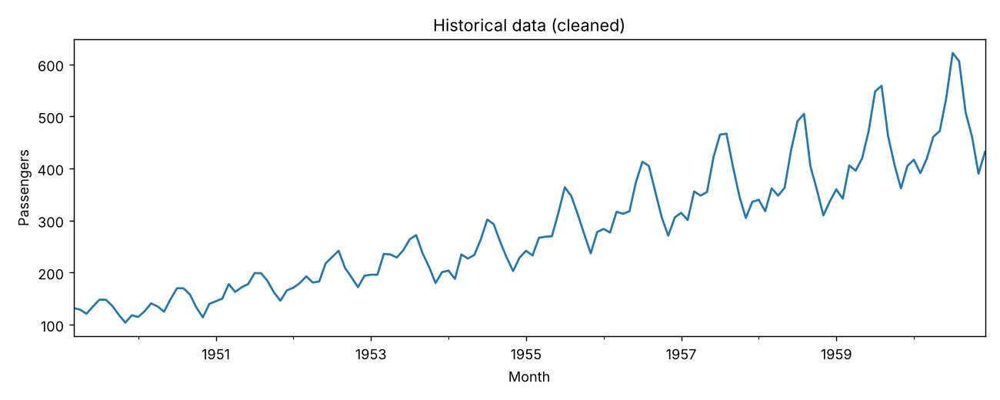
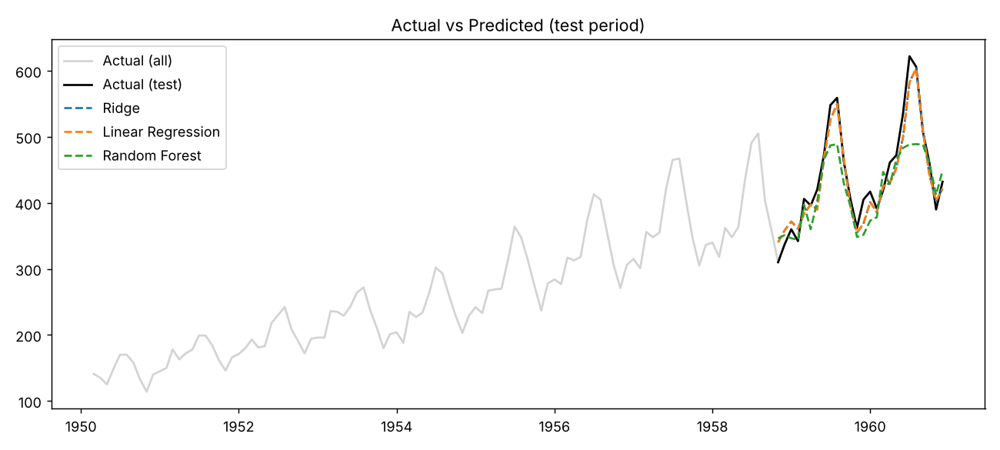
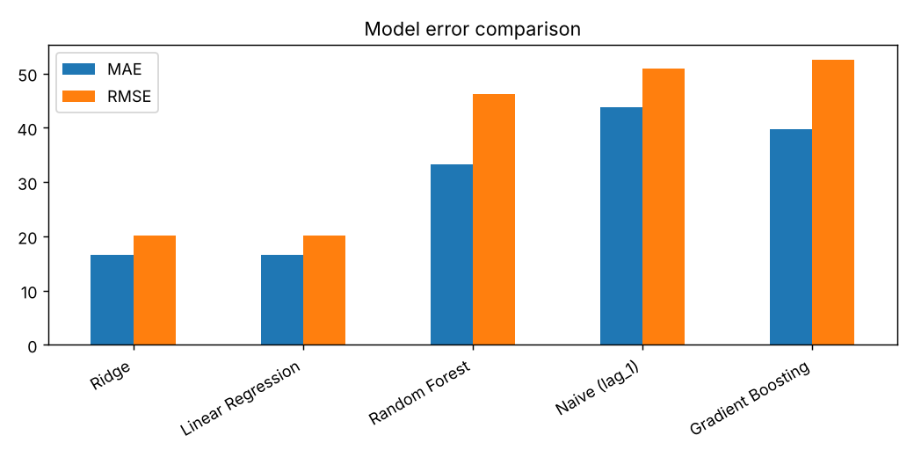
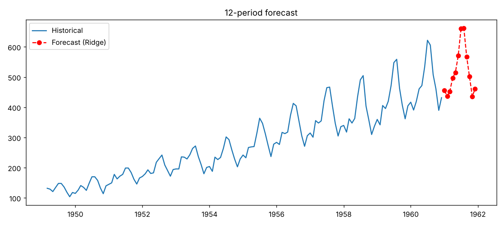

# Predictive Analytics Using Historical Data

A predictive modelling project that forecasts future trends from real historical data using regression models, with a full pipeline for cleaning, feature engineering, evaluation and visualization.

## Dataset

**Monthly International Airline Passengers** (in thousands), March 1949 to December 1960 (142 monthly observations). The series has a clear upward trend and yearly seasonality, which makes it a classic benchmark for forecasting.

File: `airline_passengers.csv`

## Approach

1. **Clean and preprocess:** parse dates, remove duplicates, set a regular monthly frequency, detect outliers (IQR rule) and fill missing values by time interpolation.
2. **Feature engineering:** lag features (1, 2, 3, 6, 12 months), rolling means, time index and cyclical month encoding.
3. **Time-based split:** the first 80% of the series is used for training and the last 20% for testing. The data is never shuffled, to avoid leakage from the future.
4. **Models:** Linear Regression, Ridge, Random Forest and Gradient Boosting, compared against a naive baseline (last month's value). Holt-Winters is included and runs automatically if `statsmodels` is installed.
5. **Evaluation:** MAE, RMSE, MAPE and R².
6. **Forecast:** the best model is retrained on all data and predicts the next 12 months.

## Results (test set)

| Model | MAE | RMSE | MAPE | R² |
|---|---|---|---|---|
| **Ridge** | **16.5** | **20.1** | **3.8%** | **0.94** |
| Linear Regression | 16.6 | 20.2 | 3.9% | 0.94 |
| Random Forest | 33.2 | 46.3 | 7.0% | 0.66 |
| Naive (last month) | 43.7 | 50.9 | 9.9% | 0.59 |
| Gradient Boosting | 39.7 | 52.6 | 8.3% | 0.56 |

Ridge performed best. The tree-based models struggled because they cannot predict values beyond the range seen in training, and the passenger counts keep rising. The linear models extrapolate the trend.

## Visualizations

**Historical data**



**Actual vs predicted (test period)**



**Model error comparison**



**12-month forecast (1961)**



The forecast shows continued growth with the seasonal summer peak in July and August.

## Run it

```bash
pip install pandas numpy scikit-learn matplotlib
pip install statsmodels   # optional, enables Holt-Winters
python predictive_analytics.py
```

To use your own data:

```bash
python predictive_analytics.py yourfile.csv DateColumn TargetColumn
```

## Files

| File | Description |
|---|---|
| `predictive_analytics.py` | Full pipeline: cleaning, features, models, evaluation, plots, forecast |
| `airline_passengers.csv` | Real historical dataset |
| `model_comparison.csv` | Test-set metrics for every model |
| `future_forecast.csv` | 12-month forecast |
| `*.png` | Charts |

## Tools

Python, pandas, NumPy, scikit-learn, Matplotlib.
